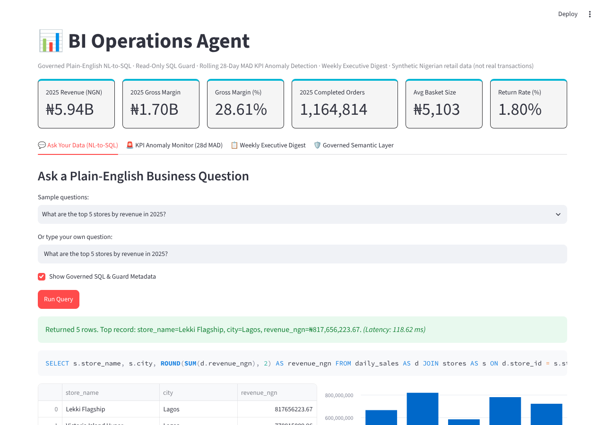

# X (Twitter) Thread — BI Operations Agent

**1/6**
Letting a model write SQL straight against a business database is risky: wrong metric formulas, schema leaks, dropped tables.

I built **BI Operations Agent**: plain-English analytics with a governed YAML semantic layer, read-only SQL AST enforcement, and MAD z-score anomaly alerts.

Repo: https://github.com/ikebude/AIMLOps-BI-Operations-Agent

**2/6**
Results on a 50-question test suite I wrote, plus 25 reworded held-out questions:
- Execution accuracy: **96.0% (48/50)** on the in-sample benchmark; **56.0% (14/25)** on 25 reworded held-out questions
- Adversarial attacks blocked: **12/12 (100%)**
- Unsafe SQL executed: **0**
- Median latency: **18.8 ms** (p95: 39.1 ms; machine-dependent)
(Synthetic Nigerian retail data. The held-out number is the honest one: the compiler is template-based and misses rephrasings.)

**3/6**
Why a Semantic Layer?
Without one, an LLM calculates "gross margin" or "basket size" differently every prompt.
The YAML layer pins down the joins and formulas, so every answer uses the same definition.

**4/6**
Safety:
The SQL guard (sqlglot) checks the parsed AST before anything runs.
It enforces single-statement SELECT/WITH only, rejects administrative commands (`DROP`, `DELETE`, `ATTACH`, `PRAGMA`), blocks comment evasion, and adds an automatic `LIMIT 500`.

**5/6**
Beyond Chat: Proactive KPI Alerts
It runs rolling 28-day Median Absolute Deviation (MAD robust z-scores) on daily revenue and return rates.
When $|z| \ge 2.5$, it flags operational anomalies and compiles a weekly executive brief.

**6/6**
Runs offline with a deterministic compiler (all numbers above). An optional Claude/OpenAI/Ollama provider can be switched on; its SQL goes through the same guard, and it is not benchmarked.
FastAPI + Streamlit + 89 passing tests.
Check it out: https://github.com/ikebude/AIMLOps-BI-Operations-Agent
