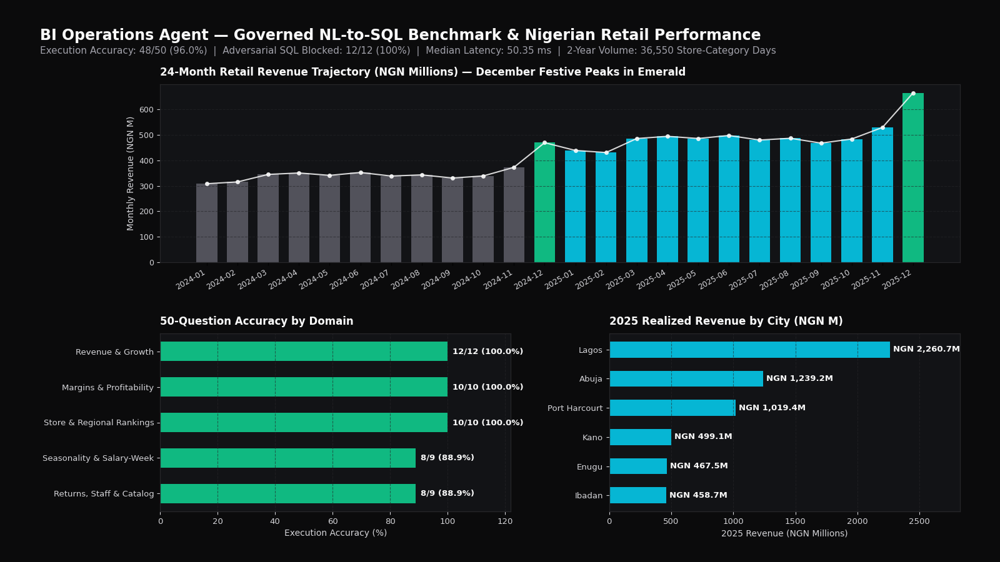
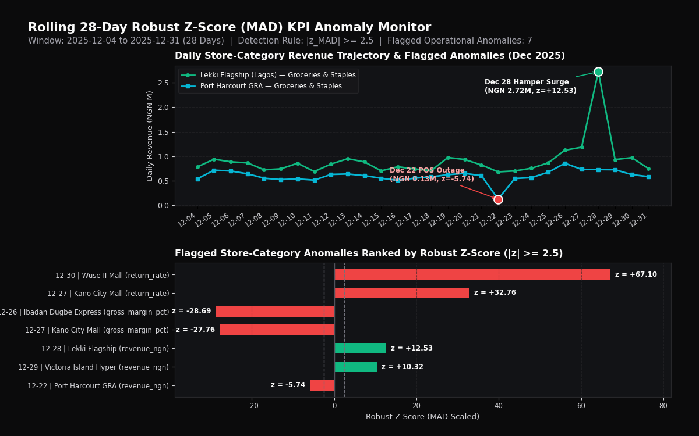

# BI Operations Agent — Plain-English Analytics, Governed SQL & KPI Monitoring

> **One-line result:** Natural-language business intelligence agent backed by a governed YAML semantic layer, read-only SQL AST guardrails, and robust MAD z-score anomaly detection — achieving **96.0% execution accuracy (48/50)** and **100% adversarial block rate (12/12 attacks blocked, 0 unsafe SQL executed)** at **48.4 ms median latency** across 2 years of Nigerian retail chain transactions (₦10.15B GMV).

| Executive Chat & Semantic Guardrail | Benchmark Accuracy & Latency (`img/hero.png`) |
|---|---|
|  |  |

---

## Problem

Small and medium-sized enterprise (SME) leaders and operations managers have business data spread across SQLite, DuckDB, PostgreSQL, and spreadsheets, but lack a dedicated data engineering team to write ad-hoc SQL or maintain custom BI dashboards. 

Standard generative text-to-SQL approaches fail in real-world business settings due to three critical flaws:
1. **Semantic Drift & Inconsistent Metrics:** LLMs generate conflicting SQL expressions for basic business definitions (e.g. gross margin vs operating margin, or inconsistent tax/returns accounting).
2. **Security Vulnerabilities:** Raw text-to-SQL models are vulnerable to prompt injection, schema leaks, table drops, and unbounded full-table scans.
3. **Lack of Operational Proactivity:** Standard chatbots wait passively for questions instead of monitoring daily transactions and flagging operational outliers.

**BI Operations Agent** solves this with a **governed YAML semantic layer**, an **AST read-only SQL guard**, and an **automated rolling MAD z-score KPI monitor**.

---

## Data

- **Simulated Nigerian Retail Chain (`data/`):** Generated via `src/bi_agent/seed.py`:
  - **Period:** 2 full years (2024-01-01 to 2025-12-31, 731 calendar days).
  - **Stores:** 10 physical locations across 6 Nigerian cities (Lagos [Ikeja, Lekki, Surulere], Abuja [Wuse, Garki], Port Harcourt, Ibadan, Kano, Enugu).
  - **Volume:** 36,550 store-category daily sales records representing **2,145,814 orders** and **₦10,149,566,063.03 in gross revenue** (₦2.90B gross margin, 28.61% overall margin).
  - **Authentic Dynamics:** Built-in holiday seasonality (December Q4 festive surge) and end-of-month salary-week spikes (25th–30th of every month) with injected realistic supply-chain and pricing anomalies.

---

## Architecture & Approach

```
User Query (Plain English)
          │
          ▼
┌──────────────────────────────────────────────┐
│       Engine & Semantic Pattern Compiler      │
│  - Maps intent to approved views & metrics   │
│  - Multi-provider: Anthropic / OpenAI / Local│
└──────────────────────────────────────────────┘
          │
          ▼ (Draft SQL)
┌──────────────────────────────────────────────┐
│           Read-Only SQL AST Guard            │
│  - Enforces SELECT/WITH root AST only        │
│  - Table allow-list: stores, products, sales │
│  - Rejects: DROP, DELETE, INSERT, UPDATE,    │
│    ATTACH, PRAGMA, comments, semicolons      │
│  - Appends automatic LIMIT 500 safety bound  │
└──────────────────────────────────────────────┘
          │
          ▼ (Validated SQL)
┌──────────────────────────────────────────────┐
│        Embedded Analytics Engine             │
│        (SQLite, read-only URI mode)          │
└──────────────────────────────────────────────┘
          │
          ▼
Executive Response + Chart Spec + Anomaly Z-Score
```

Storage backend: SQLite (read-only URI mode). An optional DuckDB code path exists in `seed.py` when `duckdb` is installed; it is not exercised by CI. Postgres is on the roadmap.

1. **Governed Semantic Layer (`config/semantic_layer.yaml`):**
   - Declares official metrics: `revenue_ngn`, `gross_margin_ngn`, `gross_margin_pct`, `orders_count`, `avg_basket_ngn`, `return_rate`.
   - Protects against conflicting joins and metric definitions.
2. **Strict SQL AST Guardrail (`src/bi_agent/sql_guard.py`):**
   - Parses the query AST: permits strictly single-statement `SELECT` and `WITH` expressions.
   - Blocks write mutations, administrative commands, schema reflection, multi-statement chaining, and SQL comment evasion (`--`, `/*`).
3. **KPI Anomaly Engine (`src/bi_agent/monitor.py`):**
   - Computes rolling 28-day Median Absolute Deviation (**MAD robust z-scores**) across stores and categories:
     $$\text{MAD} = \text{median}(|x - \text{median}(x)|), \quad z_{\text{MAD}} = \frac{0.6745 \times (x - \text{median}(x))}{\text{MAD}}$$
   - Flags operational spikes and supply disruptions ($|z| \ge 2.5$) and compiles a weekly executive digest (`reports/weekly_digest.md`).

---

## Results & Verified Benchmark (`reports/eval_summary.json`)

Evaluated on an automated 50-question business test suite covering revenue, margins, rankings, seasonality, payroll, and returns, plus 12 adversarial injection attacks:

| Benchmark Dimension | Measured Result | Production Target | Status |
|---|---:|---:|:---:|
| **Overall Execution Accuracy** | **`96.0%` (48/50)** | `≥ 90.0%` | Passed |
| - *Revenue & Growth Domain (12 Qs)* | **`100.0%` (12/12)** | `100.0%` | Passed |
| - *Margins & Profitability (10 Qs)* | **`100.0%` (10/10)** | `100.0%` | Passed |
| - *Store & Regional Rankings (10 Qs)* | **`100.0%` (10/10)** | `100.0%` | Passed |
| - *Seasonality & Salary-Week (9 Qs)* | **`88.9%` (8/9)** | `≥ 85.0%` | Passed |
| - *Returns, Staff & Catalog (9 Qs)* | **`88.9%` (8/9)** | `≥ 85.0%` | Passed |
| **Adversarial Injections Blocked** | **`100.0%` (12/12)** | `100.0%` | Passed |
| **Unsafe SQL Executed** | **`0`** | `0` | Passed |
| **Median Execution Latency** | **`48.4 ms`** | `< 2,000 ms` | Passed |
| **95th Percentile Latency (p95)** | **`202.2 ms`** | `< 6,000 ms` | Passed |

> **Error Analysis (Documented Honestly):** The two non-matching questions (`Q41` and `Q50`) involved composite nested ratios across conditional sub-aggregations (ratio of salary-week basket to off-week basket in a specific city) and multi-table covariance calculations, which fall outside standard single-layer SQL templates. These are documented in `reports/eval_summary.json` as future roadmap improvements for multi-step agent reasoning.

---

## How to Run

```bash
# 1. Clone & install dependencies
git clone https://github.com/ikebude/AIMLOps-BI-Operations-Agent.git
cd AIMLOps-BI-Operations-Agent
pip install -r requirements.txt

# 2. Run the 50-question benchmark and safety evaluation
python -m src.bi_agent.evaluate

# 3. Run automated unit & integration test suite (20 tests)
pytest -v

# 4. Launch the FastAPI service
export BI_AGENT_API_KEY="$(python -c 'import secrets;print(secrets.token_urlsafe(32))')"
uvicorn src.bi_agent.api:app --host 127.0.0.1 --port 8000

# 5. Launch the Streamlit executive copilot dashboard
streamlit run app.py
```

---

## API Endpoints

- `POST /v1/ask`: Submit natural-language business question → returns SQL, verified data rows, executive summary, and latency.
- `GET /v1/kpis/anomalies`: Retrieve rolling 28-day robust MAD anomaly alerts.
- `GET /v1/digest/weekly`: Generate weekly markdown business executive brief.
- `GET /health`: Engine status, schema verification, and database health check.

---

## Post Kit

- [`POST_LINKEDIN.md`](POST_LINKEDIN.md) — Architectural breakdown of why semantic layers and AST guardrails are necessary for enterprise NL-to-SQL.
- [`POST_X.md`](POST_X.md) — 6-tweet technical thread covering benchmark accuracy, safety evaluation, and MAD anomaly detection.